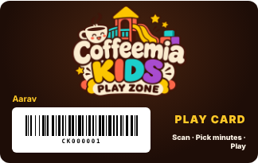
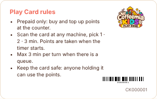
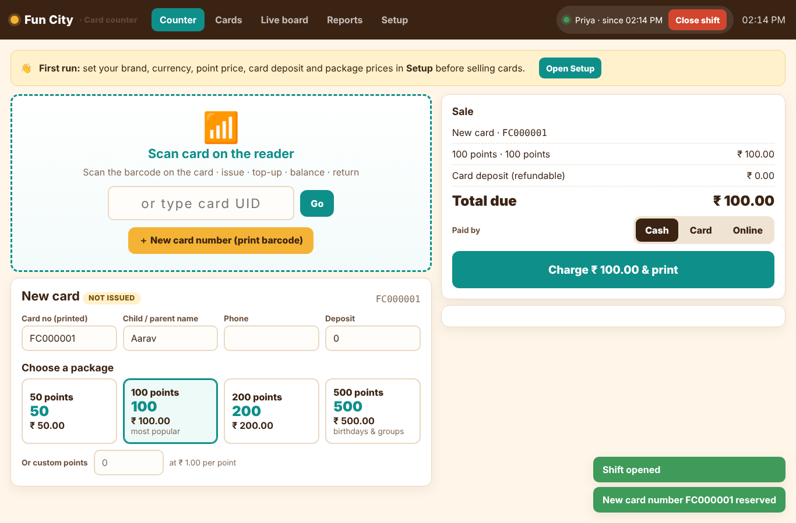
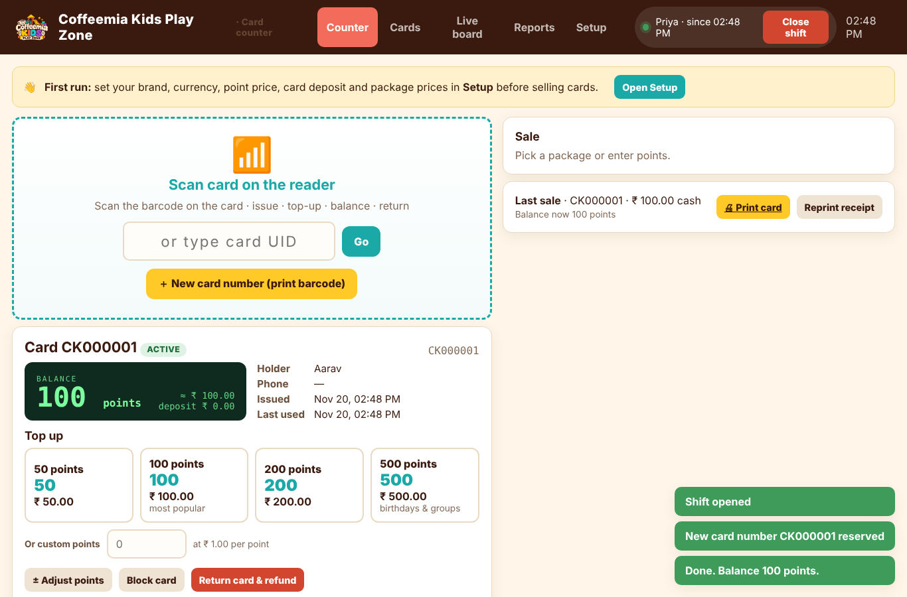
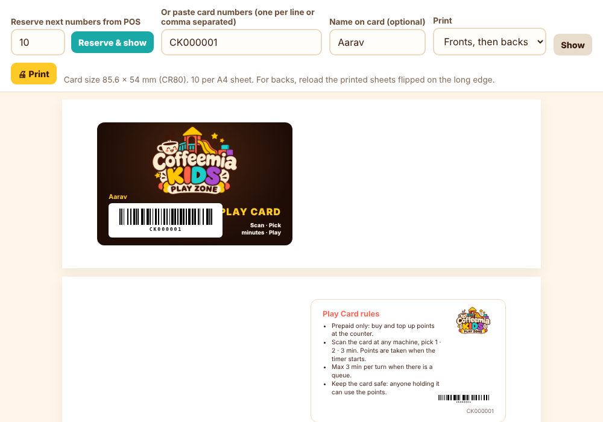
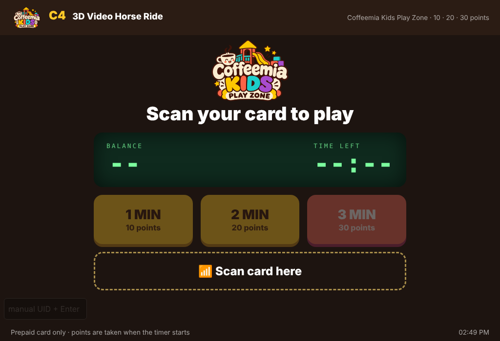
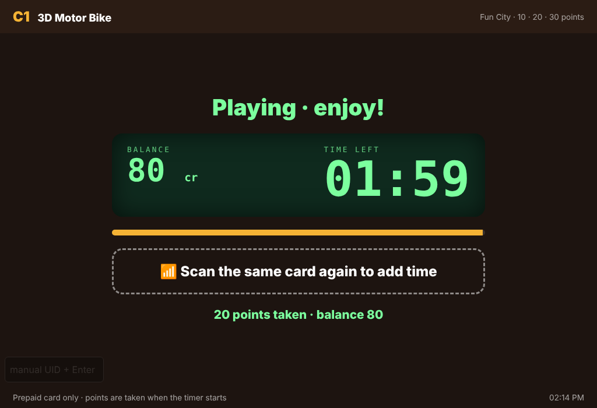
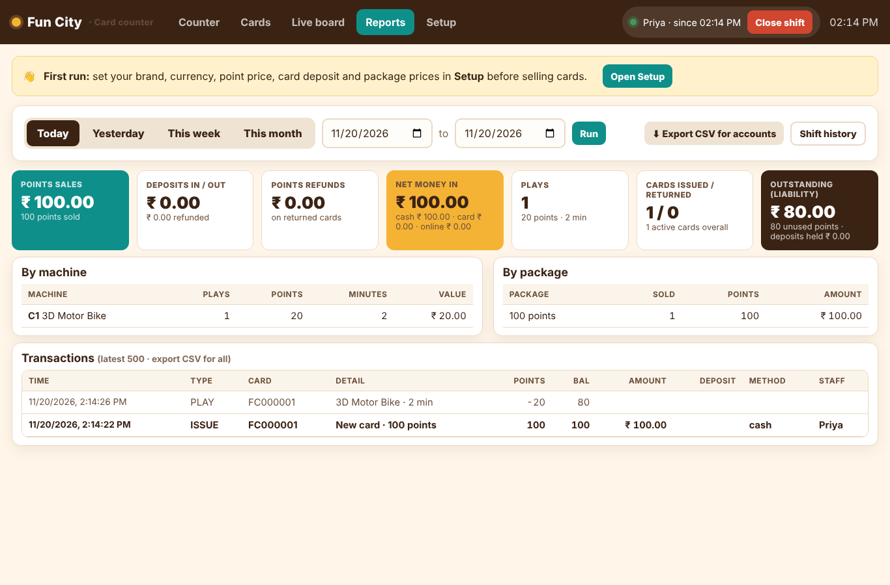

# Coffeemia Kids Play Zone · Play-Card POS (barcode)

Prepaid card system for the kids play zone. The customer pays at the counter, gets a card with a
printed **barcode**, and scans it at each machine to play. **₹1 = 1 point**: pay ₹100, get 100 points.

The same barcode scanner model is fixed on every toy / machine, so one card works everywhere.
An RFID reader works too (it types the card UID the same way) if you ever switch.

```
Customer pays ₹100 ──► counter scans card ──► 100 points on the card
Kid scans card at a toy ──► picks 1 · 2 · 3 min ──► points taken ──► toy runs, timer counts down
```

## What is in the box

| Screen | URL | Used by |
|---|---|---|
| Counter POS | `http://<pos-pc>:8787/` | Staff: generate / issue cards, top-up, balance, return, block, receipt, shift cash, reports, setup |
| Print cards | `http://<pos-pc>:8787/print-cards` | Prints the card design with barcode, 10 per A4 sheet |
| Station screen | `http://<pos-pc>:8787/station?machine=C1` | A tablet / mini PC + USB barcode scanner on each machine |
| Live board | Counter POS → *Live board* | Staff see every machine's timer at a glance |

Zero dependencies: Node.js 22.5+ only (built-in SQLite). The database is one file: `data/funcity.db`.

## The card

The print page makes a CR80 card (85.6 × 54 mm, same as a bank card) with:

- front: the Coffeemia Kids logo on dark brown, **PLAY CARD**, a Code 128 barcode with the card number under it, "Scan · Pick minutes · Play";
- back (optional): the card rules and a small barcode.

Card numbers are generated by the POS: prefix + running number (`CK000001`, `CK000002` …), set in
Setup. The **barcode value is the card number**, so a printed card is ready to issue the moment it is
scanned at the counter for the first time.

Two ways to work:

1. **Pre-print a stock of cards.** Print cards → *Reserve next 10/50/100 numbers* → print on PVC card
   sheets or thick paper, laminate if you print on paper. Keep them at the counter. Customer pays,
   staff scan a blank card, enter name/phone, choose points, charge. Done.
2. **Print on demand.** Counter → *New card number (print barcode)* → charge → *Print card*.

Barcodes can be photographed and copied, unlike RFID. Keep points per card modest, and use *Block card*
if a card is misused. If you later want tamper-proof cards, switch the readers to RFID; nothing else changes.

## Install on the counter PC (Windows, Mac or Linux)

1. Install Node.js 22 LTS or newer from nodejs.org.
2. Copy this folder to the PC (e.g. `C:\funcity-pos`).
3. Open a terminal in that folder and run:

```bash
npm start
```

4. Open `http://localhost:8787/` in Chrome or Edge. Go to **Setup** (default PIN `1234`): check the
   brand, price per point (₹1), packages, and the points per minute for each machine, then change the PIN.
5. Click **Open shift** before the first sale of the day.

To start automatically on boot, create a scheduled task / autostart entry that runs `npm start` in the folder.
Give the PC a fixed LAN address on the router so the station screens always find it.

## Running it on Railway (internet) instead of a counter PC

The repo root has a `package.json`, `.node-version` and `railway.json`, so Railway builds it with no root-directory
setting. After connecting the GitHub repo:

1. **Variables** → add `POS_PASSWORD` = a strong password. Every screen (counter and stations) will ask for it
   once; the username can be anything. Without it, anyone with the URL could issue cards.
2. **Volume** → add a volume (any mount path, e.g. `/data`). The database is created there automatically, so
   cards and sales survive redeploys. Without a volume all data is lost on every deploy.
3. **Settings → Networking → Generate Domain** to get the public URL. Use it as `<pos-pc>` in the station URLs.

The counter PC and the station tablets then just open that URL. Scanners still plug into the local devices.

## Scanner setup

A USB barcode scanner works as a **keyboard**: it types the code and presses Enter. No driver needed.

- Counter: plug the scanner into the counter PC. Scan a card anywhere on the Counter POS page and the card
  opens. Staff do not need to click into a box first.
- Stations: each machine gets a small screen (old Android tablet with a USB-OTG scanner, a Raspberry Pi, or a
  mini PC) with its own scanner. Open the station URL in a kiosk / full-screen browser:

```
http://<pos-pc>:8787/station?machine=A      Kids basketball
http://<pos-pc>:8787/station?machine=C4     3D video horse ride
http://<pos-pc>:8787/station?machine=D1     RC racing driver 1   (… D2, D3, D4)
http://<pos-pc>:8787/station?machine=H      Air hockey (per game)
```

Open `/station` with no code to pick from a list. Add `&auto=1` if a machine has no touch screen: scanning
the card then starts 1 minute (or 1 game) immediately.

Buy scanners that read **Code 128** (every 1D scanner does), ideally with a stand or fixed mount so kids just
hold the card under it. Set the scanner's suffix to Enter (the factory default).

### Switching the toy on and off (optional)

In Setup → Machines, each machine can have a **start webhook** and **stop webhook** URL. The server calls the
start URL when a play begins and the stop URL when the timer ends (also after a server restart). Any Wi-Fi smart
plug or relay with an HTTP API works, e.g. a Shelly plug: `http://192.168.1.50/relay/0?turn=on` and
`…?turn=off`. For coin-slot toys, an ESP relay that pulses the coin line works the same way.

## Points and prices

- **₹1 = 1 point** (Setup → *Price of 1 point*). Packages are seeded at 50 / 100 / 200 / 500 points at par.
  For offers like "75 points for ₹50", edit a package and put 25 in *Bonus*.
- Machines are seeded with placeholder points per 1 / 2 / 3 minutes (rides 10 / 20 / 30, basketball 20 / 30 / 40,
  RC racing 20 / 40 / 50, air hockey 30 per game, toy catcher 20 per play). **Set your real prices in Setup.**
- Card deposit is **0** by default. Set an amount in Setup if you want a refundable deposit.

## Daily operation

- **Open shift** (staff name + opening cash) → sell → **Close shift** (count the drawer; the POS shows expected
  cash and the difference). Shift history is in Reports.
- **New card:** scan a blank printed card (or click *New card number*) → name, phone → choose points →
  Charge & print receipt.
- **Top-up:** scan card → choose package or custom points → Charge & print.
- **Return card:** scan card → *Return card & refund* (PIN). Unused points are refunded or forfeited according to
  the Setup policy, plus the deposit if you charge one.
- **Toy failed mid-way:** scan card → *Adjust points* (PIN) → +points with a reason. Recorded, no money moves.
- **Lost card:** *Block card*, or find it in **Cards** by name/phone and open it.

## Reports and the group accounts

Reports → pick a range → tiles show point sales, deposits, refunds, net money in by cash / card / online,
plays and minutes per machine, package mix, and the **outstanding liability** (unused points on cards).

**Export CSV for accounts** downloads every transaction in the range with a `company` column (`FUNCITY`, set in
Setup) so the file can be imported into the group accounting system alongside the other companies.
Each row has the type (ISSUE / TOPUP / PLAY / RETURN / ADJUST), points, money amount, payment method, shift
and staff.

Accounting treatment, for reference: money for points is received in advance; the income is earned when
points are **used** (PLAY rows). The liability tile is what is still owed to card holders.

## Settings reference (Setup tab)

| Setting | Meaning |
|---|---|
| Price of 1 point | ₹ per point. Used for custom top-ups, refunds of unused points and report values |
| Card prefix / digits / next number | How printed card numbers look (`CK` + 6 digits) and the next one to print |
| Card deposit | Charged on every new card, refunded on return. 0 = no deposit |
| Refund unused points on return | Yes = pay back points × price; No = forfeited |
| Max minutes per turn | 3 by default ("max 3 min per turn when there is a queue") |
| Station: seconds to pick minutes | How long the station waits after a scan before returning to idle |
| Admin PIN | Protects Setup, adjustments, unblock, returns / refunds and stopping a play |

## Developer notes

```bash
npm test         # API + barcode tests (node:test, in-memory database)
npm run dev      # restart on file change
PORT=9000 FUNCITY_DB=/path/funcity.db npm start
```

Layout: `server/db.js` schema + seed, `server/api.js` business rules, `server/index.js` HTTP + routes,
`public/` the screens (`js/barcode.js` is the Code 128 encoder, `js/scan.js` the scanner capture),
`test/` tests. Back up `data/funcity.db` daily (copy the file; it is SQLite).

## Logo

The logo lives in `public/img/` (`logo.png` 720 px for cards, receipts and station screens, `logo-small.png`
for headers, `favicon.png`). To change it, replace those files; no code changes needed.

## Screenshots

| Play card: front | Play card: back |
|---|---|
|  |  |

| Counter: new card | Counter: card open |
|---|---|
|  |  |

| Print cards | Station: idle |
|---|---|
|  |  |

| Station: running | Reports |
|---|---|
|  |  |
