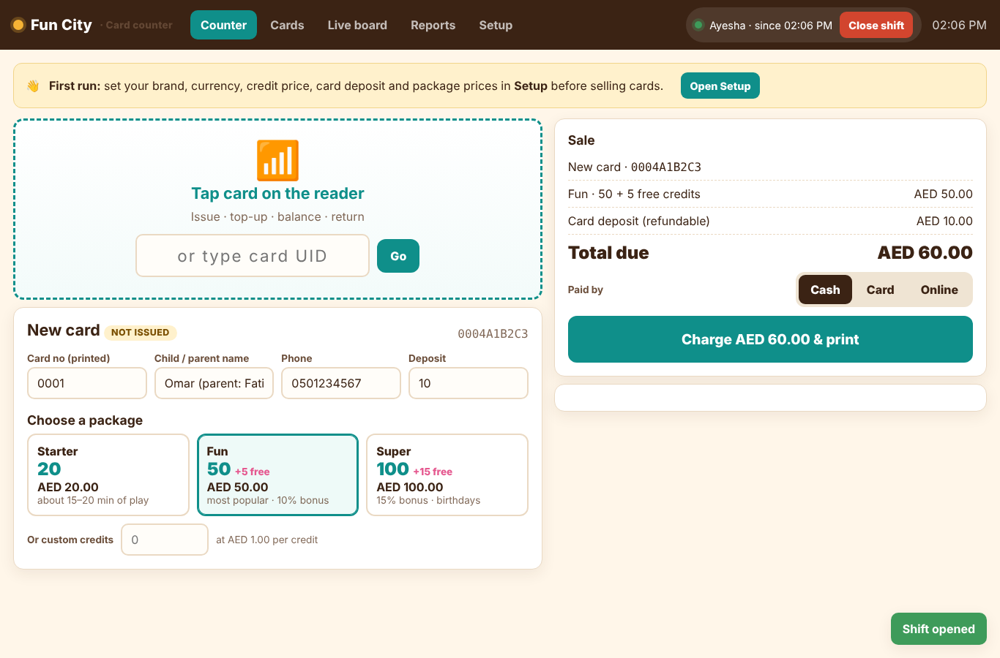
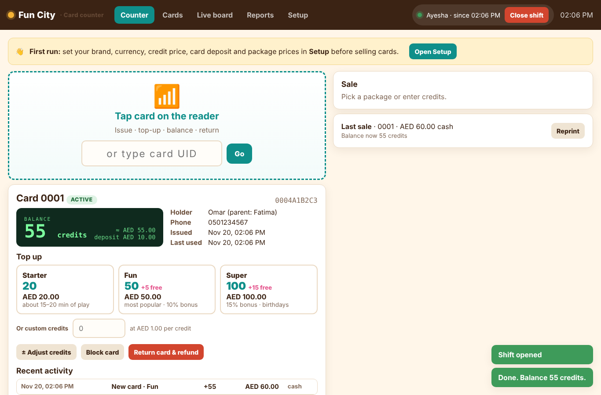
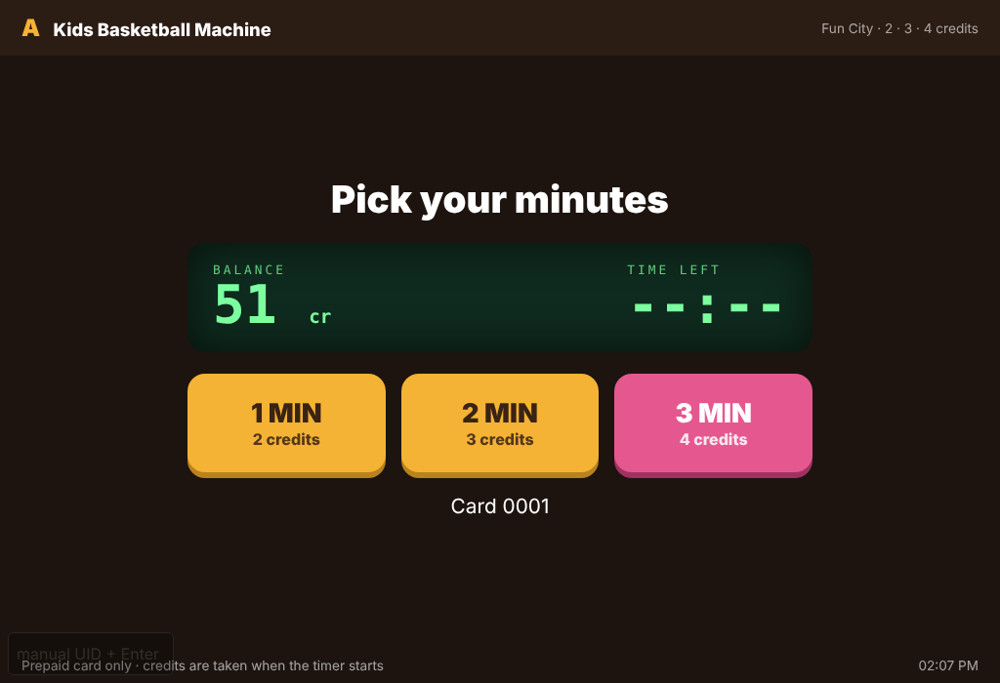
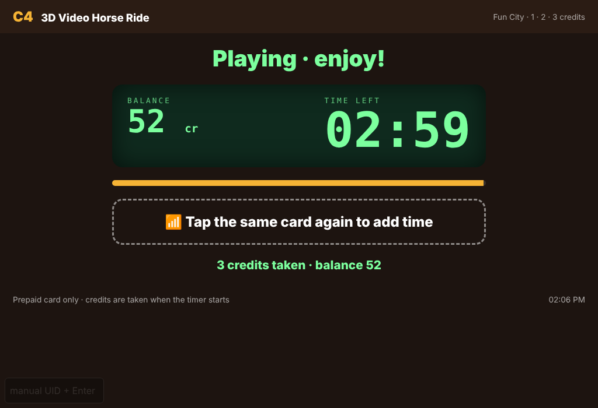
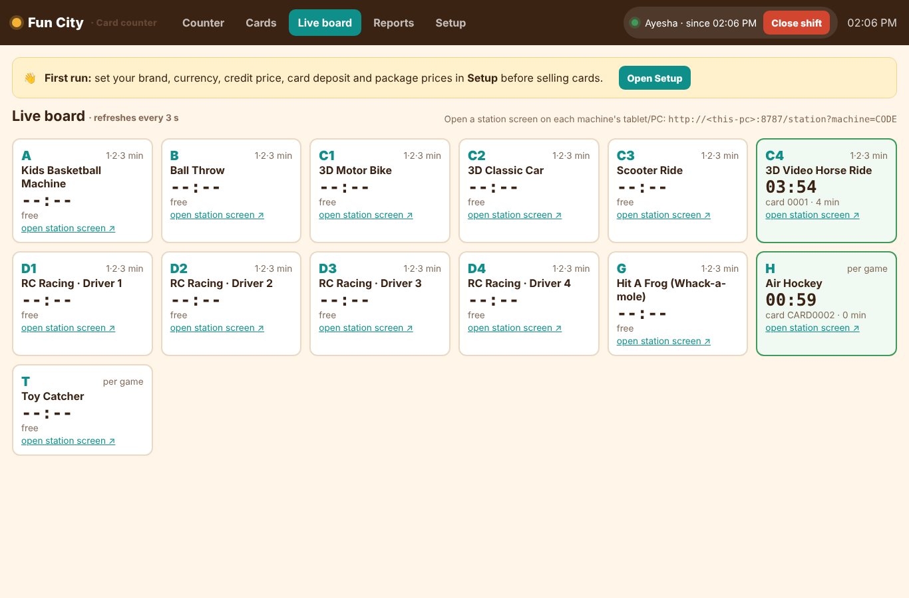
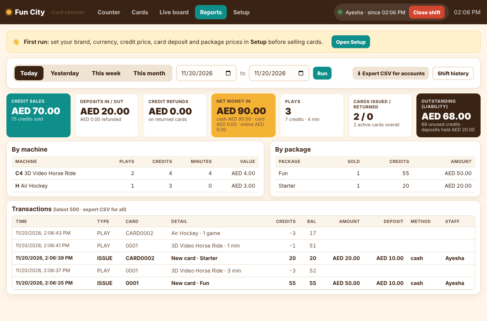

# Fun City · RFID Play-Card POS

Prepaid RFID card system for the kids play zone, built to the approved floor plan
(card counter **E**, nine card-timed stations, RC racing track with four driver stations) and the
supplier's equipment list (Hit A Frog, 3D Video Horse Ride, 3D Motor Bike, 3D Classic Car, Air Hockey,
Toy Catcher, Kids Basketball Machine, RFID reader + USB RFID POS reader).

How it works for the customer, exactly as on the pricing sheet:

1. **Buy / top up** a Play Card at counter E (Starter 20 · Fun 50 + 5 free · Super 100 + 15 free, or custom credits).
2. **Tap** the card on any machine's reader. The station screen shows the balance.
3. **Pick 1, 2 or 3 minutes.** Credits are taken up front. Air Hockey and Toy Catcher are per game.
4. **Timer counts down** on screen, the machine stops at 00:00. Tap again to add time.
5. Card is returned at the counter: deposit (and, by policy, unused credits) refunded.

## What is in the box

| Screen | URL | Used by |
|---|---|---|
| Counter POS | `http://<pos-pc>:8787/` | Staff at counter E: issue, top-up, balance, return, block, receipts, shift cash, reports, setup |
| Station screen | `http://<pos-pc>:8787/station?machine=C1` | A tablet / mini PC + USB RFID reader on each machine |
| Live board | Counter POS → *Live board* | Staff see every machine's timer at a glance |

Zero dependencies: Node.js 22.5+ only (built-in SQLite). The database is one file: `data/funcity.db`.

## Install on the counter PC (Windows, Mac or Linux)

1. Install Node.js 22 LTS or newer from nodejs.org.
2. Copy this folder to the PC (e.g. `C:\funcity-pos`).
3. Open a terminal in that folder and run:

```bash
npm start
```

4. Open `http://localhost:8787/` in Chrome or Edge. Go to **Setup** (default PIN `1234`), set brand,
   currency, credit price, card deposit, package prices and machine credit prices, then change the PIN.
5. Click **Open shift** before the first sale of the day.

To start automatically on boot, create a scheduled task / autostart entry that runs `npm start` in the folder.
Find the PC's LAN IP (`ipconfig` / `ifconfig`) and give it a fixed address on the router so the station screens
always find it.

## RFID reader setup

The USB RFID reader works as a **keyboard**: it types the card's UID and presses Enter. No driver is needed.

- Plug it into the counter PC. Tap a card anywhere on the Counter POS page: the card opens. Staff do not need
  to click into a text box first.
- If the reader adds a prefix/suffix, or types the UID in decimal instead of hex, it does not matter: the
  POS stores whatever the reader types (letters/digits only, upper-cased). **Use the same reader model on every
  station** so a card has the same UID everywhere. If you must mix models, check that both output the same format
  (most have a config tool to pick 10-digit decimal / 8-hex / Wiegand).
- Readers that do not send Enter are also handled (the POS fires after a 250 ms pause).
- Recommended cards: MIFARE Classic 1K / NTAG 13.56 MHz, printed with a short card number (0001, 0002 …).
  The printed number is what staff type to find a card if the chip fails.

### Station screens

Each machine needs a small screen with a USB RFID reader (an old Android tablet with a USB-OTG reader, a
Raspberry Pi, or a mini PC all work). Open the station URL in a kiosk/full-screen browser:

```
http://<pos-pc>:8787/station?machine=A      Kids basketball
http://<pos-pc>:8787/station?machine=C4     3D video horse ride
http://<pos-pc>:8787/station?machine=D1     RC racing driver 1   (… D2, D3, D4)
http://<pos-pc>:8787/station?machine=H      Air hockey (per game)
```

Open `/station` with no code to pick from a list. Add `&auto=1` if a machine has no touch screen: tapping the
card then starts 1 minute (or 1 game) immediately.

### Switching the machine on and off (optional)

In Setup → Machines, each machine can have a **start webhook** and **stop webhook** URL. The server calls the
start URL when a play begins and the stop URL when the timer ends (also after a server restart). Any Wi-Fi smart
plug or relay with an HTTP API works, e.g. a Shelly plug: `http://192.168.1.50/relay/0?turn=on` and
`…?turn=off`. For coin-slot machines, an ESP relay that pulses the coin line works the same way.

## Daily operation

- **Open shift** (staff name + opening cash) → sell → **Close shift** (count the drawer; the POS shows expected
  cash and the difference). Shift history is in Reports.
- **New card:** tap unknown card → enter printed card no, name, phone → choose package → Charge & print.
  Total = package price + deposit.
- **Top-up:** tap card → choose package or custom credits → Charge & print.
- **Return card:** tap card → *Return card & refund* (PIN). Deposit comes back; unused credits are refunded or
  forfeited according to the Setup policy.
- **Ride failed mid-way:** tap card → *Adjust credits* (PIN) → +credits with a reason. Recorded, no money moves.
- **Lost card:** tap any card → *Block card*, or find it in **Cards** by name/phone and open it.

## Reports and the group accounts

Reports → pick a range → tiles show credit sales, deposits in/out, refunds, net money in by cash/card/online,
plays and minutes per machine, package mix, and the **outstanding liability** (unused credits + deposits held).

**Export CSV for accounts** downloads every transaction in the range with a `company` column (`FUNCITY`, set in
Setup) so the file can be imported straight into the group accounting system alongside the other companies.
Each row has the type (ISSUE / TOPUP / PLAY / RETURN / ADJUST), credits, money amount, deposit, payment method,
shift and staff.

Accounting treatment, for reference: credit sales and deposits are received in advance; the income is earned
when credits are **used** (PLAY rows). The liability tile is what is still owed to card holders.

## Settings reference (Setup tab)

| Setting | Meaning |
|---|---|
| Price of 1 credit | Used for custom top-ups, refunds of unused credits, and the value shown in reports |
| Card deposit | Charged on every new card, refunded on return |
| Refund unused credits on return | Yes = pay back credits × credit price; No = forfeited |
| Max minutes per turn | 3 by default, as on the card rules ("max 3 min per turn when there is a queue") |
| Station: seconds to pick minutes | How long the station waits after a tap before returning to idle |
| Admin PIN | Protects Setup, adjustments, unblock, returns/refunds and stopping a play |

## Developer notes

```bash
npm test         # API tests (node:test, in-memory database)
npm run dev      # restart on file change
PORT=9000 FUNCITY_DB=/path/funcity.db npm start
```

Layout: `server/db.js` schema + seed, `server/api.js` business rules, `server/index.js` HTTP + routes,
`public/` the two screens, `test/` API tests. Back up `data/funcity.db` daily (copy the file; it is SQLite).

## Screenshots

| Counter: new card | Counter: card open |
|---|---|
|  |  |

| Station: pick minutes | Station: running |
|---|---|
|  |  |

| Live board | Reports |
|---|---|
|  |  |
